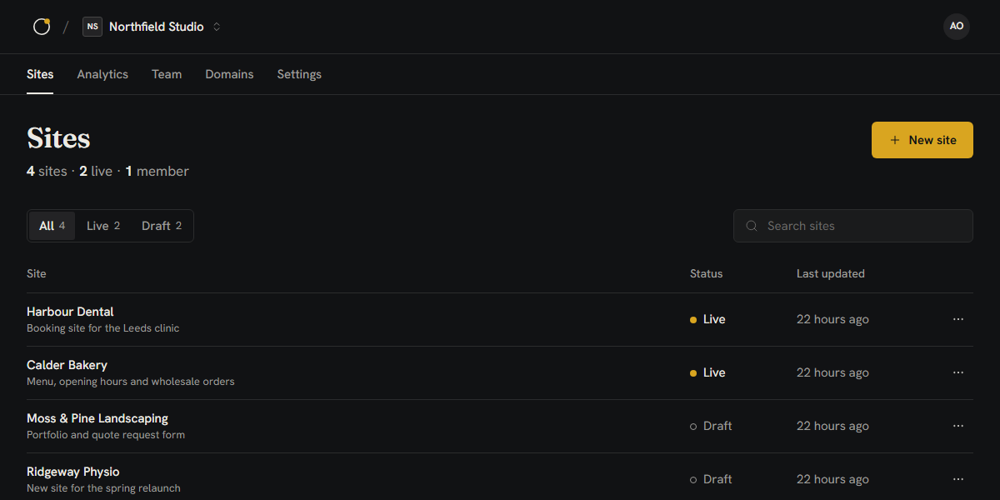

# SiteOrbit

[](https://github.com/UzomaN-Hub/SiteOrbit/actions/workflows/ci.yml)

A website builder for teams that build sites for clients. Each client gets its own workspace, with its own sites, team roles, domains, brand settings and analytics.

**Live:** [site-orbit-beta.vercel.app](https://site-orbit-beta.vercel.app) · **API:** [SiteOrbit-Backend](https://github.com/UzomaN-Hub/SiteOrbit-Backend)



## What you can do

- **Sites.** Create a site per client project, see which are live or in draft, and publish from one table.
- **Visual builder.** Build pages from sections (hero, text, features, call to action), preview them at desktop, tablet and phone widths, and publish.
- **Workspaces and roles.** Keep each client separate. Invite people as owner, admin, editor or viewer; the interface and the API both enforce what each role can do.
- **Analytics.** Visits, conversions, top pages and traffic sources for each site, over 7, 30 or 90 days.
- **Domains and branding.** Add a client's domains and set the colours, type and spacing their sites use.
- **Sign-in.** Email and password, Google or GitHub.

## Stack

| | |
|---|---|
| Framework | Next.js 16 (App Router), React 19, TypeScript (strict) |
| Styling | Tailwind CSS 4 with a token-only design system (`app/globals.css`) |
| UI primitives | Radix UI, restyled; Lucide icons |
| Data | TanStack Query for server state, Zustand for session and builder state |
| Forms | React Hook Form and Zod |
| Charts | Recharts |
| Tests | Playwright (end-to-end, accessibility with axe, design checks) |
| Hosting | Vercel (web), Render (API) |

Motion is plain CSS plus one shared `IntersectionObserver`; there's no animation library. [`docs/DECISIONS.md`](docs/DECISIONS.md) explains why.

## Design

Three colours (carbon `#111214`, bone `#ECEAE4`, amber `#D9A520`), two typefaces (Fraunces for headings, Hanken Grotesk for everything else), and radius and size set by an element's role. The full system is in [`docs/redesign/DESIGN.md`](docs/redesign/DESIGN.md).

`npm run lint:design` fails the build if code drifts back to gradients, glows, blur, pill shapes, uppercase eyebrow labels, raw colour values, placeholder links or page-load spinners.

## Run it locally

You need Node 20.9+ and the [API](https://github.com/UzomaN-Hub/SiteOrbit-Backend) running on port 8000.

```bash
npm install
cp .env.example .env.local
npm run dev            # http://localhost:4317
```

| Script | What it does |
|---|---|
| `npm run dev` | Dev server on port 4317 |
| `npm run check` | Typecheck, ESLint, design lint and production build |
| `npm run test:e2e` | Builds, serves on port 4318 and runs the Playwright suite |
| `node scripts/screenshots.mjs` | Captures review screenshots into `docs/redesign/screenshots/` |

Signed-in tests need a test account: put `E2E_EMAIL` and `E2E_PASSWORD` in `.env.test.local` (git-ignored). Without them those tests skip.

## Project layout

```
app/
  (marketing)/      landing page
  (auth)/           sign in, sign up, password help, accept invite
  (app)/            signed-in pages: sites, analytics, team, domains, settings
  (editor)/builder  full-screen builder
components/
  ui/               restyled primitives (button, input, dialog, menu, table…)
  app-shell/        top bar, workspace switcher, account menu
  sites/ builder/ analytics/ team/ settings/ marketing/ auth/
hooks/              data hooks (one per API area)
store/              Zustand stores (session, workspace, builder)
lib/                API client, validators, config, formatting
scripts/            design lint, screenshot capture
tests/              Playwright specs
docs/               decisions, progress, learning notes, redesign spec
```

## Docs

- [`docs/PROGRESS.md`](docs/PROGRESS.md): what's done, what's next
- [`docs/DECISIONS.md`](docs/DECISIONS.md): why things are the way they are
- [`docs/LEARNING.md`](docs/LEARNING.md): concepts this project uses, with a study path
- [`CONTRIBUTING.md`](CONTRIBUTING.md): branches, commits and pull requests
